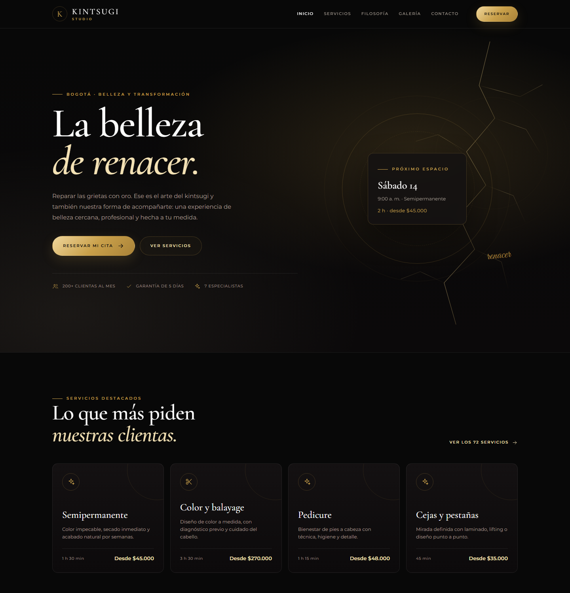
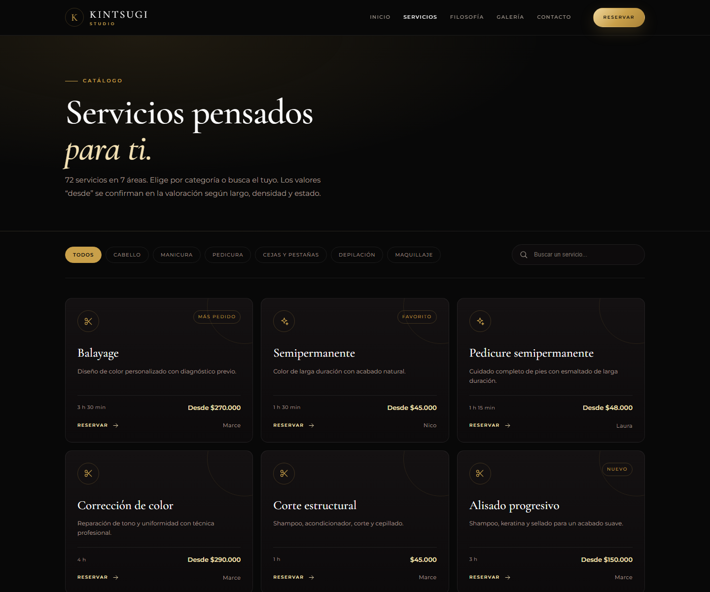
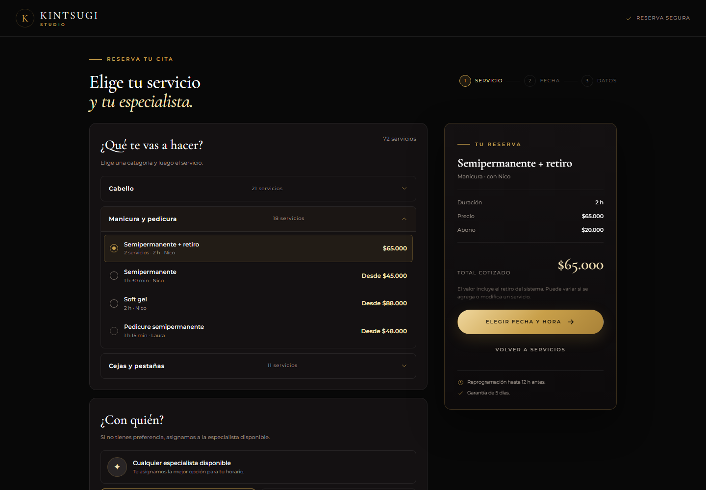
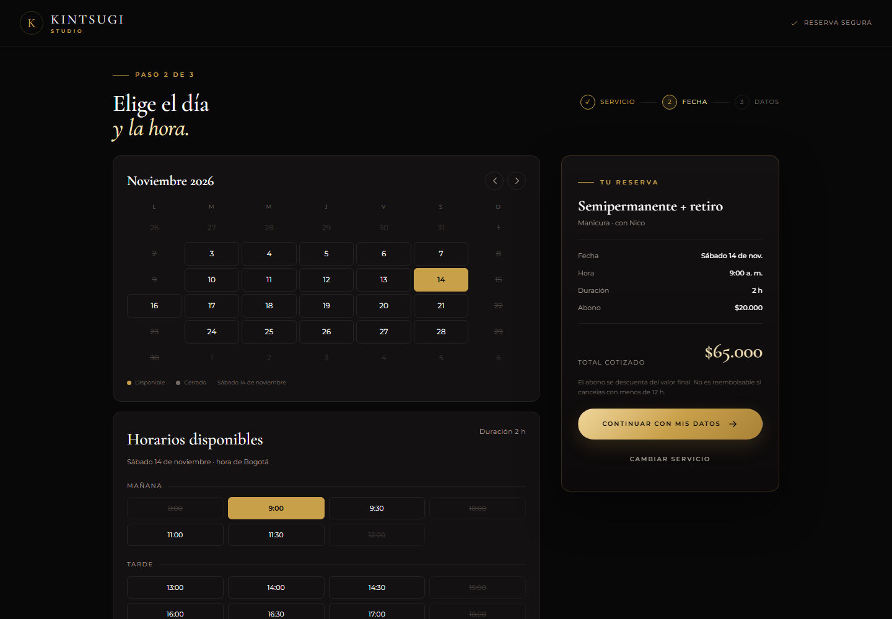
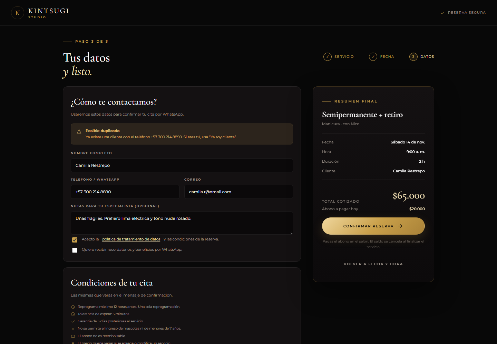
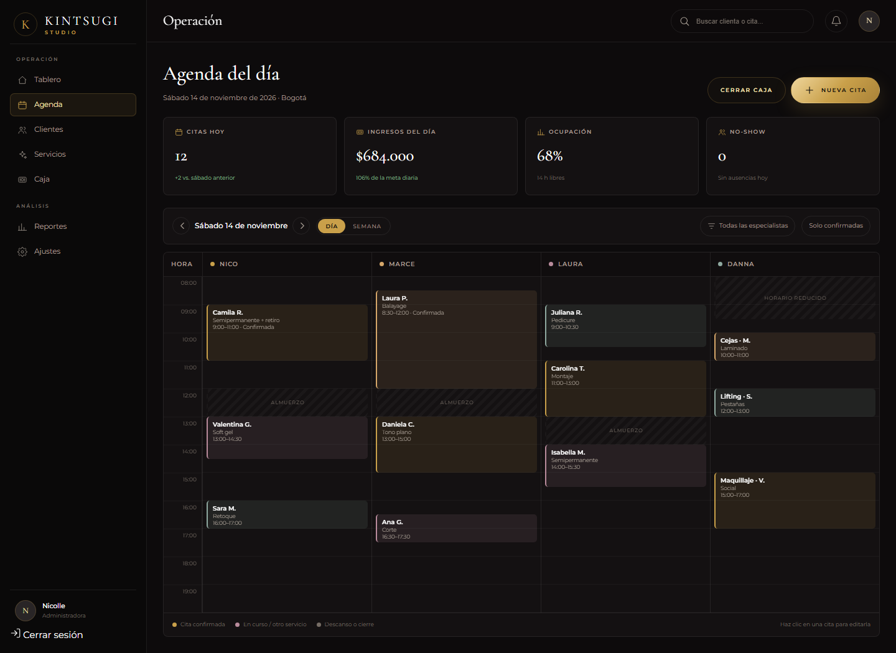
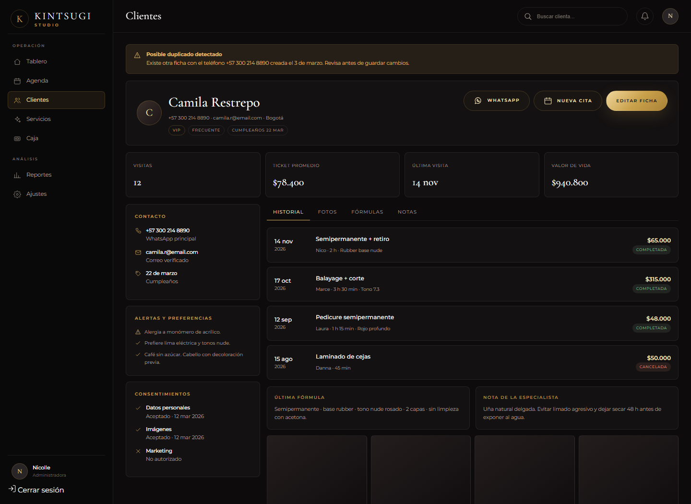
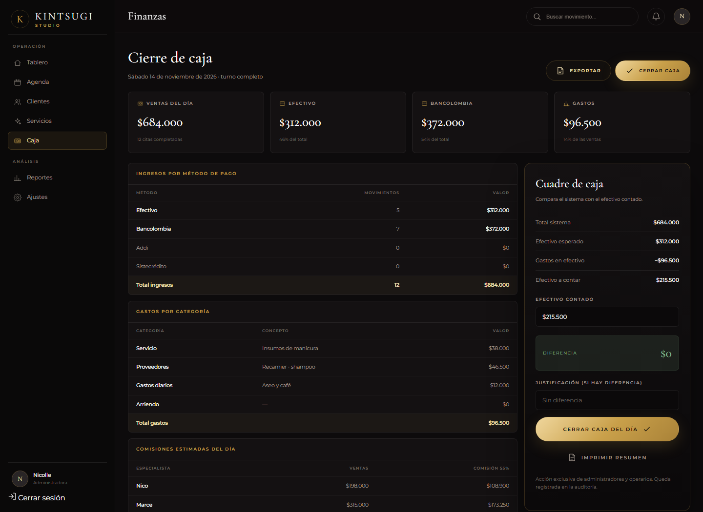

# Diseño de interfaz — Kintsugi Studio

> **Estado:** prototipo de diseño navegable, previo a la implementación en Next.js.
> **Prototipo:** [`frontend/prototype/index.html`](../frontend/prototype/index.html).
> **Capturas:** [`docs/assets/ui/`](assets/ui/).
> **Última actualización:** 10 de noviembre de 2026.

Este documento define el sistema visual, los principios de experiencia de usuario y la
estructura de las ocho pantallas principales del producto. La implementación debe reutilizar
los mismos tokens y contratos de componentes.

## 1. Principios de UX

### 1.1 Ley de Jakob

Los usuarios ya conocen los patrones de otros sitios. La interfaz los reutiliza para reducir el
aprendizaje:

- Navegación superior fija y un CTA principal en el sitio público.
- Flujo de reserva en tres pasos con resumen persistente.
- Calendario a la izquierda y horarios a la derecha.
- Panel administrativo con barra lateral, barra superior, KPIs y grilla de agenda.
- Ficha de clienta con cabecera de perfil, estadísticas y pestañas.

### 1.2 Ley de Hick

Cada pantalla reduce el número de decisiones simultáneas:

| Punto de decisión | Reducción |
|---|---|
| Navegación pública | 5 enlaces + 1 CTA de reserva. |
| Navegación administrativa | 5 secciones principales + 2 de análisis. |
| Catálogo | 7 categorías en lugar de 72 servicios visibles. |
| Reserva paso 1 | Una categoría abierta y 4 servicios visibles. |
| Reserva paso 2 | Horarios agrupados en mañana y tarde. |
| Agenda | Vista de día por defecto; la semana es un cambio deliberado. |
| Ficha | 4 pestañas en lugar de una página larga. |

### 1.3 Carga cognitiva

- **Fragmentación:** la reserva se divide en servicio/profesional, fecha/hora y datos.
- **Divulgación progresiva:** acordeones en servicios, pestañas en la ficha y justificación de
  caja solo cuando hay diferencia.
- **Reconocimiento sobre recuerdo:** el resumen repite servicio, profesional, fecha, hora,
  duración, precio y abono en cada paso.
- **Prevención de errores:** advertencia de duplicado, horarios deshabilitados, consentimiento
  explícito y confirmación antes de cerrar caja.
- **Jerarquía:** una sola acción principal por pantalla; el oro se reserva para ella.

### 1.4 Principio de Pareto

El 20 % de las acciones que generan el 80 % del valor queda arriba del pliegue:

- **Inicio:** “Reservar mi cita” y los cuatro servicios más pedidos.
- **Servicios:** las categorías de mayor demanda primero.
- **Reserva:** reserva como invitada y opción “cualquier especialista”.
- **Agenda:** citas del día, ingresos, ocupación, no-show, “Nueva cita” y “Cerrar caja”.
- **Ficha:** alertas, contacto, estadísticas e historial reciente.
- **Caja:** ventas, efectivo, banco, gastos y diferencia.

### 1.5 Accesibilidad

- Contraste mínimo 4.5:1 para texto de cuerpo sobre fondo oscuro.
- Foco visible dorado en todos los elementos interactivos.
- Etiquetas visibles en los formularios; los placeholders son ejemplos, no etiquetas.
- Objetivos táctiles de al menos 44 px en móvil.
- Los estados no dependen solo del color: también usan texto, opacidad o tachado.

## 2. Sistema visual

### 2.1 Colores

| Token | HEX | Uso |
|---|---|---|
| `--ink` | `#080808` | Fondo principal, superficies premium, navegación. |
| `--gold` | `#C9A04A` | Acento, acciones principales, estados activos, líneas finas. |
| `--champagne` | `#F4E2B5` | Titulares editoriales, valores seleccionados. |
| `--pearl` | `#FFFFFF` | Texto principal y superficies de alto contraste. |
| `--graphite` | `#292526` | Superficies secundarias y separadores. |
| `--muted` | `#A99F95` | Texto secundario y metadatos. |
| `--success` | `#83B98D` | Confirmado, completado, caja cuadrada. |
| `--warn` | `#E0B86A` | Retención temporal, duplicado, pendiente. |
| `--danger` | `#D98A7E` | Cancelado, diferencia, error bloqueante. |

Proporción orientativa: 50 % negro, 25 % perla/champagne, 20 % oro y 5 % grafito. El oro es un
acento, no un relleno dominante.

### 2.2 Tipografía

| Familia | Uso | Pesos |
|---|---|---|
| **Cormorant Garamond** | Titulares editoriales, precios y cifras clave. | 400, 500, 600, itálica. |
| **Montserrat** | Navegación, cuerpo, formularios, tablas y botones. | 300, 400, 500, 600, 700. |
| **Great Vibes** | Acento emocional breve. | 400. |

### 2.3 Espaciado, radios y elevación

- Escala: 4, 8, 12, 16, 24, 32, 48, 64, 96 px.
- Radios: 4 px para elementos compactos, 8–14 px para tarjetas, 999 px para píldoras.
- Sombra suave solo para el resumen flotante y la tarjeta de caja.
- Bordes: `rgba(201,160,74,.24)` para selección y `rgba(255,255,255,.08)` para estructura.

### 2.4 Iconografía e imágenes

- Iconos de línea, trazo de 1.5 px, 18 px base, `currentColor`.
- Sin emojis en pantallas operativas.
- La grieta dorada se usa como línea orgánica fina, nunca como textura que reduzca la lectura.
- Producción usará fotografía autorizada de antes/después, con luz cálida o neutra y fondos
  limpios.

## 3. Arquitectura de información

```text
SITIO PÚBLICO
  /                         Inicio
  /servicios                Catálogo
  /reservar                 Reserva
      paso 1                Servicio + profesional
      paso 2                Fecha + hora
      paso 3                Datos + confirmación
  /filosofia                Filosofía (futuro)
  /galeria                  Galería (futuro)
  /contacto                 Contacto y ubicación (futuro)

PORTAL DE CLIENTA (futuro)
  /mi-cuenta                Citas próximas y pasadas
  /mi-cuenta/historial      Historial en modo lectura
  /mi-cuenta/consentimientos Gestión de consentimientos

PANEL ADMINISTRATIVO
  /admin                    Tablero diario
  /admin/agenda             Agenda diaria y semanal
  /admin/clientes           Lista y búsqueda de clientas
  /admin/clientes/:id       Ficha de clienta
  /admin/servicios          Catálogo y profesionales
  /admin/caja               Cierre de caja
  /admin/reportes           Reportes (fase 2)
  /admin/ajustes            Configuración (solo operario)
```

## 4. Pantallas

### 4.1 Inicio

**Propósito:** comunicar la marca, la propuesta de valor y la acción principal de reserva.

**Acción principal:** “Reservar mi cita”.

**Estructura:** cabecera fija; hero con el eslogan oficial, CTA principal y secundario, y fila de
confianza; tarjeta de próximo espacio; cuatro servicios destacados; filosofía con tres
principios; galería; testimonios; banda champagne con el eslogan; pie con contacto, dirección,
redes y políticas.

**Decisión UX:** Jakob (página de marca conocida), Hick (un CTA), Pareto (servicios más
pedidos), carga cognitiva (una idea por sección).



### 4.2 Servicios

**Propósito:** ayudar a elegir un servicio con confianza.

**Acción principal:** “Reservar” en cada tarjeta.

**Estructura:** hero de catálogo con la regla de precios “desde”; barra con siete categorías y
buscador; grilla de tarjetas con nombre, descripción, duración, precio, profesional y enlace de
reserva; banda de asesoría por WhatsApp.

**Decisión UX:** Hick (categorías en lugar de 72 servicios), Jakob (grilla de comercio
electrónico), carga cognitiva (precio y duración antes de abrir el detalle).



### 4.3 Reserva — paso 1: servicio y profesional

**Propósito:** elegir qué se va a hacer y quién lo atiende.

**Acción principal:** “Elegir fecha y hora”.

**Estructura:** cabecera mínima; indicador de tres pasos; acordeón de servicios con una
categoría abierta; selector de profesional con “Cualquier especialista disponible” primero;
resumen persistente con servicio, profesional, duración, precio, abono y total.

**Decisión UX:** Hick (una categoría abierta, opción “cualquiera”), carga cognitiva (resumen
repetido), Jakob (wizard), Pareto (reserva como invitada).



### 4.4 Reserva — paso 2: fecha y hora

**Propósito:** mostrar disponibilidad real y capturar el horario.

**Acción principal:** “Continuar con mis datos”.

**Estructura:** indicador de pasos; calendario compacto con días disponibles y cerrados;
horarios agrupados en mañana y tarde; aviso de retención de diez minutos; resumen con fecha,
hora, duración, abono y total.

**Decisión UX:** Hick (solo horarios disponibles), carga cognitiva (calendario y horarios en una
pantalla), Jakob (patrón calendario + slots), prevención de errores (retención y slots
deshabilitados).



### 4.5 Reserva — paso 3: datos y confirmación

**Propósito:** recoger los datos y confirmar la cita.

**Acción principal:** “Confirmar reserva”.

**Estructura:** indicador de pasos; advertencia de posible duplicado; formulario con nombre,
teléfono, correo y notas; consentimiento de datos y de marketing; panel con las ocho políticas;
resumen final con servicio, profesional, fecha, hora, duración, clienta, total, abono y nota de
pago.

**Decisión UX:** carga cognitiva (un formulario en dos columnas), prevención de errores
(duplicado y consentimiento), Jakob (resumen de checkout), Pareto (sin crear cuenta).



### 4.6 Agenda administrativa

**Propósito:** dar a la administradora una vista confiable del día y la semana.

**Acción principal:** “Nueva cita”; secundaria “Cerrar caja”.

**Estructura:** barra lateral (Tablero, Agenda, Clientes, Servicios, Caja; Reportes, Ajustes) y
barra superior; cuatro KPIs (citas, ingresos, ocupación, no-show); navegación por fecha, cambio
día/semana, filtro por profesional y estado; grilla con una columna por profesional, filas de
08:00 a 19:00, tarjetas de cita y bloques de descanso; leyenda de estados.

**Decisión UX:** Jakob (panel y grilla conocidos), Hick (cinco secciones, vista de día), carga
cognitiva (KPIs antes del detalle), Pareto (cifras y acciones del día arriba).



### 4.7 Ficha de clienta

**Propósito:** centralizar el historial y las notas de servicio.

**Acción principal:** “Nueva cita”; secundarias “Editar ficha” y “WhatsApp”.

**Estructura:** advertencia de duplicado; cabecera con nombre, contacto, etiquetas y acciones;
cuatro estadísticas (visitas, ticket promedio, última visita, valor de vida); columna izquierda
con contacto, alertas/preferencias y consentimientos; columna derecha con pestañas (Historial,
Fotos, Fórmulas, Notas), línea de tiempo, última fórmula, nota de la especialista y fotos.

**Decisión UX:** carga cognitiva (pestañas y tarjetas), Pareto (alertas, estadísticas e historial
reciente primero), Jakob (perfil + pestañas), reconocimiento (duplicado y consentimientos).



### 4.8 Cierre de caja

**Propósito:** cerrar el día y comparar el total del sistema con el efectivo contado.

**Acción principal:** “Cerrar caja del día”.

**Estructura:** barra lateral y título con fecha y turno; cuatro KPIs (ventas, efectivo, banco,
gastos); ingresos por método de pago; gastos por categoría; comisiones estimadas; tarjeta de
cuadre con total del sistema, efectivo esperado, gastos en efectivo, efectivo a contar, efectivo
contado, diferencia, justificación, cierre e impresión; nota de auditoría.

**Decisión UX:** Pareto (cinco cifras responden la pregunta del día), Hick (una acción de
cierre), carga cognitiva (tablas por categoría y una sola cifra de diferencia), prevención de
errores (justificación y auditoría).



## 5. Componentes

| Componente | Variantes | Uso |
|---|---|---|
| `Button` | gold, outline, ghost, small, block, disabled | Una acción dorada por pantalla. |
| `Chip` | default, active | Filtros de categoría. |
| `ServiceCard` | default, featured, wide | Inicio y catálogo. |
| `Panel` | default, summary, cash | Agrupación de contenido. |
| `ChoiceRow` | radio, selected | Selección de servicios. |
| `ProfessionalCard` | default, selected | Selección de profesional. |
| `Calendar` | available, selected, closed | Selección de fecha. |
| `TimeSlot` | available, selected, disabled | Selección de hora. |
| `SummaryCard` | booking, final | Resumen persistente de la reserva. |
| `KpiCard` | default, positive, warning | Métricas del panel. |
| `AppointmentCard` | confirmed, in-progress, completed, rest | Grilla de agenda. |
| `TimelineItem` | completed, pending, cancelled | Historial de servicios. |
| `Table` | default, total row | Caja y reportes. |
| `StatusBadge` | done, pending, cancel | Estados de cita y pago. |
| `Alert` | warning, danger, success | Duplicado, retención, diferencia. |
| `Field` | input, textarea, select, checkbox | Formularios. |

## 6. Estados e interacción

### 6.1 Reserva

```text
inicio → servicio elegido → profesional elegido → fecha elegida → horario retenido
       → datos completos → consentimiento → cita creada (pendiente/confirmada)
```

- El resumen se actualiza después de cada selección.
- El horario se retiene diez minutos; el aviso permanece visible en los pasos 2 y 3.
- Si la retención expira, el horario se libera y se ofrecen alternativas.
- La pantalla de confirmación muestra el total y el abono junto con las políticas.

### 6.2 Citas

| Estado | Visual | Acciones |
|---|---|---|
| `pendiente` | insignia de advertencia | Confirmar, reprogramar, cancelar. |
| `confirmada` | insignia de éxito / borde dorado | Completar, no-show, reprogramar, cancelar. |
| `completada` | tarjeta atenuada | Agregar notas, fotos, fórmula. |
| `cancelada` | insignia de peligro | Ver motivo. |
| `no_show` | insignia de peligro | Reprogramar, registrar nota. |

### 6.3 Estados vacíos y errores

- **Agenda vacía:** “No hay citas para este día” + “Nueva cita”.
- **Historial vacío:** “Esta clienta aún no tiene servicios” + “Agendar primera cita”.
- **Sin disponibilidad:** “No hay horarios para esta fecha” + siguiente fecha disponible.
- **Duplicado:** aviso con la ficha coincidente y dos acciones: “Ya soy clienta” / “Revisar ficha”.
- **Diferencia de caja:** el bloque cambia de verde a rojo y la justificación pasa a ser
  obligatoria.
- **Error de red:** alerta en línea con reintento; el horario seleccionado sigue visible.

## 7. Responsive

| Rango | Comportamiento |
|---|---|
| `> 1080 px` | Layout de escritorio completo. |
| `760–1080 px` | Tarjetas en dos columnas; resumen de reserva apilado. |
| `< 760 px` | Una columna; CTAs apilados; navegación pública contraída; barra lateral administrativa oculta. |

En móvil, el resumen de la reserva se convierte en una tarjeta inferior para mantener la acción
principal al alcance.

## 8. Cómo ejecutar el prototipo

```bash
cd frontend/prototype
python -m http.server 8765
```

Abrir <http://127.0.0.1:8765/index.html>.

Cada pantalla tiene una URL propia: `#home`, `#services`, `#booking-service`,
`#booking-datetime`, `#booking-confirm`, `#admin-agenda`, `#admin-client`, `#admin-cash`.

## 9. Pendientes

- [ ] Confirmar la duración estándar de cada servicio y adicional con la clienta.
- [ ] Reemplazar los placeholders por fotografía autorizada de antes/después.
- [ ] Validar la leyenda de colores de la agenda distinta al negro.
- [ ] Definir la política formal de cancelación, reprogramación y no-show.
- [ ] Confirmar si el abono se cobra en línea o en el salón.
- [ ] Portar los tokens y componentes a Next.js + Tailwind CSS.
- [ ] Validar contraste y navegación por teclado con una auditoría de accesibilidad.
